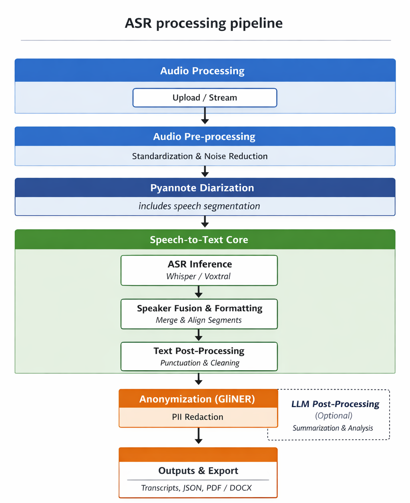

# ASR Jetson — Full Pipeline (Diarization + Transcription + Reporting)

Local end-to-end pipeline: audio ingestion → optional RNNoise denoise → Pyannote diarization → Faster-Whisper (default) or Parakeet transcription → anonymization and LLM clean-up → meeting reports (Markdown / PDF / DOCX) via Mistral.

---

<p align="center">
  
</p>

---

## Key Points
- Auto-converts audio to 16 kHz mono WAV (`preprocessing/convert_to_wav.py`), optional RNNoise denoise (`preprocessing/rnnoise.py`).
- Diarization with Pyannote (`diarization/pipeline_diarization.py`) then ASR with Faster-Whisper (default) or Parakeet (`asr/parakeet_engine.py`).
- Exports JSON, SRT, dialogue TXT, anonymized variants + mapping, meeting reports (MD/PDF/DOCX).
- Anonymization via `postprocessing/transformer_anonymizer.py`; optional LLM clean (`postprocessing/llm_clean.py`).
- ASR pipeline text anonymization uses the canonical backend entrypoint `asr_jetson.postprocessing.transformer_anonymizer.run_transformer_anonymization` (no parallel text anonymizer in nominal mode).
- Mistral-powered reports using `postprocessing/meeting_report.py` and prompts in `config/mistral_prompts.json`.

---

## Repository Layout
```
src/asr_jetson/
  asr/             # Faster-Whisper and optional Parakeet ONNX backends
  config/          # Report HTML/CSS templates + Mistral prompts
  diarization/     # Pyannote pipeline
  pipeline/        # Orchestrator and CLI (asr-pipeline)
  postprocessing/  # Anonymization, LLM clean-up, report PDF/DOCX
  preprocessing/   # WAV conversion + RNNoise
```
Other folders: `configs/` (sample YAML), `tests/` (pytest), `docker/`, `scripts/`, `models/` and `outputs/` (caches, gitignored).

---

## Installation (uv)
Prereqs: Python 3.11, `ffmpeg` in PATH, CUDA GPU recommended, `uv` installed.

```bash
uv sync --extra dev              # CPU
# uv sync --extra dev --extra gpu-linux   # GPU x86_64
# uv sync --extra dev --extra gpu-jetson  # Jetson
```
Environment:
- `HUGGINGFACE_TOKEN` required for Pyannote diarization.
- `MISTRAL_API_KEY` required for report generation.

---

## CLI Usage

```bash
uv run asr-pipeline \
  --audio path/to/file.wav \
  --out-dir outputs \
  --device cuda \
  --whisper-model large-v3 \
  --whisper-compute int8_float16 \
  --lang fr \
  --denoise \
  --speakers 2 \
  --pyannote-pipeline pyannote/speaker-diarization-3.1 \
  --pyannote-token "$HUGGINGFACE_TOKEN" \
  --asr-prompt "Kleos, Pennylane, CJD" \
  --speaker-context "Anonymized speaker context for the report" \
  --meeting-date 2026-02-15 \
  --meeting-report-type entretien_collaborateur \
  --monitor-gpu-memory
```
Main flags (see `src/asr_jetson/pipeline/cli.py`):
- `--audio` (required): input audio (wav/mp3/flac); converted to WAV internally.
- `--out-dir`: root for JSON/SRT/TXT/reports/pdf.
- `--device`: `cuda` or `cpu`; falls back to CPU if CUDA unavailable.
- `--whisper-model`: Faster-Whisper id (e.g., `large-v3`, `openai/whisper-large-v3-turbo`).
- `--whisper-compute`: CTranslate2 compute type (`int8_float16` GPU, `int8` CPU). Auto-sanitized per device.
- `--asr-backend whisper|parakeet`: default `whisper` preserves existing behavior.
- `--lang`: forced Whisper language (ISO). Default `fr`; Parakeet detects automatically.
- `--denoise`: enable RNNoise (ffmpeg arnndn/afftdn).
- `--speakers`: optional expected speaker count for Pyannote.
- `--pyannote-pipeline` / `--pyannote-token`: diarization config.
- `--asr-prompt`, `--speaker-context`, `--meeting-date`, `--meeting-report-type`: enrich transcripts and reports.
- `--report-only`: regenerate anonymization/report from existing transcripts in `out-dir`.
- `--monitor-gpu-memory`: log CUDA memory at checkpoints.

Reports: if `MISTRAL_API_KEY` or dependencies (`mistralai`, `weasyprint`, `pypandoc`, `python-docx`) are missing, report generation will error. There is no CLI switch to disable reporting.

---

## Outputs
- `json/<audio>_pyannote_<pipeline>_<whisper>.json`: diarization + ASR segments.
- `srt/<audio>_... .srt`: timestamped subtitles with speakers.
- `txt/<audio>_... .txt`: dialogue text.
- `txt/<audio>_..._clean.txt`: cleaned text when anonymization is off or when corrected.
- `txt/<audio>_..._anon.txt` and `_anon_clean.txt`: anonymized variants.
- `json/<audio>_..._anon_mapping.json`: anonymization mapping.
- `reports/<audio>_meeting_report_anonymized.md`: anonymized Mistral report.
- `reports/<audio>_meeting_report.md`, `pdf/compte_rendu_<audio>_<date>_<time>.{pdf,docx}`: deanonymized final report.
- `manifest.json`: run metadata (paths can be relative if `ASR_RECORDINGS_ROOT` is set).

---

## Parakeet TDT 0.6B v3

Both ASR backends follow `--device`: select `--asr-backend parakeet --device cuda`
for GPU transcription, or `--device cpu` explicitly for CPU inference. Whisper
remains the default backend and keeps its existing decoding settings.

```bash
# Linux x86_64, CUDA 12 / cuDNN 9 (same Torch versions as the existing pipeline)
uv sync --extra dev --extra gpu-linux --extra parakeet-cuda
uv run --extra parakeet-cuda asr-pipeline --audio meeting.wav --asr-backend parakeet --device cuda --out-dir outputs

# Optional CPU-only installation
uv sync --extra dev --extra parakeet
uv run --extra parakeet asr-pipeline --audio meeting.wav --asr-backend parakeet --device cpu --out-dir outputs
```

The `parakeet` and `parakeet-cuda` installation extras are mutually exclusive.
The CUDA wheel also supports CPU inference; Docker includes the CUDA runtime.
The selected Sherpa CUDA wheel is pinned to 1.13.4 to work with the existing
CUDA 12.6/cuDNN 9 libraries; the CPU-only wheel remains pinned to 2.0.1.
A requested CUDA run fails if no GPU or CUDA-enabled Sherpa runtime is available,
or if native initialization reports a fallback to CPU.

Parakeet uses [Sherpa-compatible ONNX exports](https://k2-fsa.github.io/sherpa/onnx/pretrained_models/offline-transducer/nemo-transducer-models.html)
of NVIDIA Parakeet-TDT-0.6B-v3. CUDA uses floating-point weights (about 2.55 GB);
CPU uses INT8 weights (about 670 MB). These exports have separate Hugging Face
caches. Weights are downloaded on first use into `HF_HOME`, never during builds.
No NeMo or Transformers upgrade is required.

For offline inference, pass `--parakeet-model-dir /models/parakeet`. CUDA requires
`encoder.onnx`, **`encoder.weights`**, `decoder.onnx`, `joiner.onnx`, and `tokens.txt`.
CPU requires `encoder.int8.onnx`, `decoder.int8.onnx`, `joiner.int8.onnx`, and
`tokens.txt`. Use the matching export, not a `.nemo` checkpoint or the INT8 export
for a CUDA run.

Language is detected automatically (including French); `--lang`, `--asr-prompt`,
`--whisper-model` and `--whisper-compute` apply only to Whisper. Speech windows
come from Pyannote, split at `--parakeet-chunk-seconds` (default 20).
Timestamps describe these audio windows rather than word-level alignment.
Overlapping turns are decoded once and assigned one speaker by the existing
speaker attachment policy. Output formats stay the same; Parakeet filenames
use `parakeet-tdt-0.6b-v3`. The manifest records the selected backend.
The original model is licensed CC BY 4.0; retain attribution to NVIDIA.

```bash
# Unit/contract regression checks (no weights required)
uv run --extra dev --extra parakeet pytest tests/test_parakeet_backend.py tests/test_transcribe_helpers.py tests/test_whisper_engine_unit.py tests/test_pipeline_helpers.py -m 'not integration'
# Real CUDA transcription and ONNX execution-profile assertion, using local weights
ASR_TEST_PARAKEET_MODEL=/models/parakeet ASR_TEST_PARAKEET_DEVICE=cuda uv run --extra parakeet-cuda pytest tests/test_parakeet_backend.py -m integration
```

## Tests

```bash
uv run pytest                 # full suite (integration needs tokens/models)
uv run pytest -m "not gpu"    # skip GPU-heavy tests
```

---

## Docker

Desktop NVIDIA / x86_64:

```bash
docker build -t asr-jetson:dev -f docker/Dockerfile .
docker run --rm asr-jetson:dev asr-pipeline --help
```

Both backends are included. No model weights or GPU are required during the
build. The first build downloads several GB of NVIDIA images and Python/CUDA
packages; subsequent builds reuse Docker's cache.

Run the complete pipeline with Parakeet and Pyannote on CUDA:

```bash
mkdir -p recordings outputs
# Place meeting.wav in recordings/; export the tokens before running.
docker run --rm --gpus all \
  -e HUGGINGFACE_TOKEN -e MISTRAL_API_KEY \
  -v "$PWD/recordings:/recordings:ro" \
  -v "$PWD/outputs:/outputs" \
  -v asr-hf-cache:/workspace/.cache/huggingface \
  asr-jetson:dev asr-pipeline \
  --audio /recordings/meeting.wav --out-dir /outputs \
  --asr-backend parakeet --device cuda
```

For the existing Whisper path, replace `--asr-backend parakeet` with
`--asr-backend whisper --whisper-model large-v3 --whisper-compute int8_float16`.
For a CPU-only host, omit `--gpus all` and use `--device cpu`; Whisper can use
`--whisper-compute int8`. NVIDIA GPU access in Docker requires a working NVIDIA
container runtime (or Docker Desktop GPU support under WSL2).

For offline Parakeet inference, additionally mount the downloaded export using
`-v /path/to/parakeet:/models/parakeet:ro` and pass
`--parakeet-model-dir /models/parakeet`. Pyannote still needs its own cached
models and access permissions; report generation uses Mistral.

Jetson / ARM64 (build on Jetson, or use an ARM64-capable Buildx builder):

```bash
docker build --platform linux/arm64 -t asr-jetson:jetson -f docker/Dockerfile.jetson .
docker run --rm asr-jetson:jetson asr-pipeline --help
```

For Jetson runs, use the same CLI options and mount the cache at
`/app/.cache/huggingface` instead of `/workspace/.cache/huggingface`.
The image runs as UID 1000: mounted output/cache directories must be writable
by that user. The ARM64 CUDA wheel targets CUDA 12.6 / cuDNN 9 (JetPack 6.2);
a compatible GPU-enabled Torch installation is also required. An ARM64 build
on a desktop does not validate CUDA on physical Jetson/JetPack hardware.

### Docker validation (2026-10-30)

- Desktop image: complete build and default entrypoint succeeded on Docker
  Desktop / WSL2, x86_64.
- Real Parakeet CUDA transcription was verified with ONNX Runtime profiling:
  model operators executed with `CUDAExecutionProvider`. The initial CPU-only
  benchmark is superseded by this CUDA backend; it does not describe GPU speed.
- 89 tests passed outside external integrations; 46 targeted tests passed inside
  the CUDA image, including real Parakeet CUDA execution through the orchestrator
  and exports (diarization/report services isolated). Explicit CPU transcription
  with the CUDA runtime was also checked.
- Real Faster-Whisper `large-v3` transcription succeeded after Parakeet in the
  same CUDA image on an RTX 4070 Ti SUPER, using `int8_float16` (no CPU fallback).
- Jetson build under x86_64 QEMU emulation failed in the Ubuntu `libc-bin`
  post-install script (`qemu: uncaught target signal 11`), before installing
  the project's Python dependencies. Running `/sbin/ldconfig` directly in the
  unmodified NVIDIA Jetson base image reproduced the crash. The complete Jetson
  image therefore remains unvalidated: build it on a native ARM64/Jetson host
  or resolve the host's ARM64 emulation first.

These Docker checks do not cover a complete Pyannote/Mistral meeting-report run
or GPU execution on physical Jetson hardware.

On the same 60-second French sample inside Docker, median ASR time over three
warm runs was **0.28 s for Parakeet CUDA**, versus **2.90 s for Faster-Whisper
large-v3 CUDA** (about 10.3x faster on this sample). Model loading took 1.29 s and
4.22 s respectively, with weights already cached. These measurements exclude
diarization, conversion, anonymization and reports, and are not a guarantee for
long meetings or other hardware. They do not measure recognition accuracy.

---

## Entry Points
- Primary entry: `uv run asr-pipeline` (alias `python -m asr_jetson.pipeline.cli`).
- Programmatic use: import and call `run_pipeline` from `pipeline/full_pipeline.py`.
- Standalone document-anonymization CLI is no longer part of this repository.
